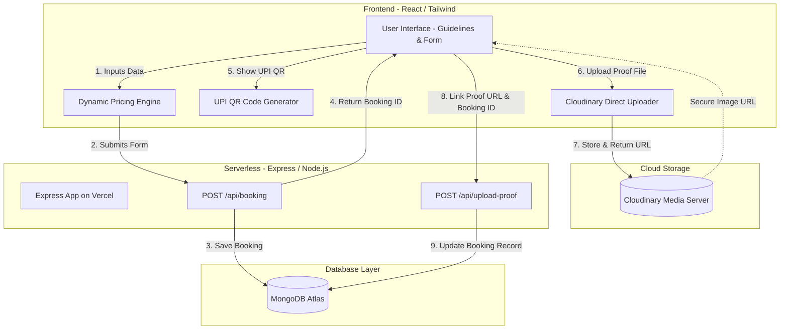

# 🚀 Plinth 2025 Registration Portal

Welcome to the official repository of the **Plinth 2025 Registration Portal**. This is a premium, full-stack event registration and payment validation web application designed specifically for **Plinth**, the annual national techno-cultural-management festival of **The LNM Institute of Information Technology (LNMIIT), Jaipur**.

The platform is engineered to handle registrations, coordinate individual and team passes, apply dynamic discount codes, generate payment workflows via UPI QR codes, and securely upload and link payment proofs.

🔗 **Deployed Application:** [plinth-registration-2025.vercel.app](https://plinth-registration-2025.vercel.app)

---

## 🌟 What is Plinth 2025 Registration?

Plinth Registration is a custom-engineered web application that streamlines the onboarding and ticketing process for festival attendees. Rather than relying on rigid, disconnected forms, this platform handles the end-to-end user journey:
1. **Explore guidelines & pricing structures** (Single-day vs. 3-day power passes, accommodation guidelines, and custom group discounts).
2. **Configure dynamic groups** by adding multiple members with custom event preferences.
3. **Apply referral codes** for automated, live discount calculations.
4. **Initiate UPI payments** with a real-time invoice breakdown (including 18% GST).
5. **Securely upload payment screenshots** directly to Cloudinary and link them with the booking ID.

---

## 🛠️ What Problems It Solves

### 1. **The "Orphaned Payment" Problem**
* **The Issue:** With forms like Google Forms, if a user makes a payment but fails to submit the form or uploads a corrupted image, matching the bank transaction reference to the user's details is extremely tedious.
* **The Solution:** The portal splits the registration into a **two-step transactional commit**. First, the booking details (members, events, base price) are saved in the database, yielding a unique `bookingId`. Only then is the user prompted to pay. If the browser closes or the upload fails, the booking record is already stored, allowing organizers to easily reconcile pending transactions.

### 2. **Dynamic Cost and Add-on Computations**
* **The Issue:** Event fests typically include complex pricing models (e.g., base pass covers one event, extra events cost ₹149 each, plus different rates for multi-day passes). Manual calculations by users lead to incorrect transfer amounts.
* **The Solution:** A client-side state machine computes prices on the fly as members are added/removed or events are selected. An 18% tax rate is cleanly displayed on the invoice before the QR code is rendered, ensuring users pay the exact amount.

### 3. **Scalable Multi-Member Registration**
* **The Issue:** Registering a team or group normally requires multiple submissions, creating data fragmentation.
* **The Solution:** The form supports adding dynamic member sub-forms. A single primary contact can register their entire group, select distinct events for each person, and make a single consolidated payment.

### 4. **Secure, Offloaded Media Storage**
* **The Issue:** Storing large payment proof images on a Vercel serverless backend exceeds payload size limits and drains server bandwidth.
* **The Solution:** The client uploads files directly to **Cloudinary** using secure signing, saving server-side bandwidth and CPU cycles. Only the lightweight, CDN-optimized image URL is stored in MongoDB.

---

## ⚡ How it is Better than Others

| Feature | Plinth Registration Portal | Google Forms / Standard Forms | Common Ticketing Platforms |
| :--- | :--- | :--- | :--- |
| **Data Integrity** | **Two-stage commit** ensures registration details are captured before payment screenshot upload. | Single submit. If image upload crashes, all inputs are lost. | Captures payments but lacks custom event multi-selection per member. |
| **Pricing Engine** | Real-time calculations for base passes, extra add-on events, and referral discounts. | Static; cannot calculate compound rules dynamically. | Hard to configure individual event add-ons under a single group pass. |
| **Referral System** | Integrated discount engine (`PLINTH2024`, `MUJ1212`) that validates and deducts live. | Not supported; requires manual reimbursement. | Extra processing fees and complex configuration. |
| **Asset Pipeline** | Bypasses backend; uploads directly to Cloudinary and stores optimized CDN URLs. | Fragmented Google Drive files, difficult to export programmatically. | High hosting costs passed onto organizers. |
| **UX & Styling** | Sleek, custom-tailored Tailwind UI, search-as-you-type event dropdowns, and step-by-step progress. | Plain, unbranded, and generic. | Rigid templates that can't be customized for the festival's theme. |

---

## 📐 Architecture Diagram



---

## 🛠️ Tech Stack

### **Frontend**
* **Framework:** React.js (v18)
* **Styling:** Tailwind CSS (v3)
* **Form Components:** `react-select` (for multi-event selection)
* **HTTP Client:** Axios
* **Icons:** `react-icons`

### **Backend**
* **Runtime:** Node.js
* **Framework:** Express.js
* **Database ODM:** Mongoose (MongoDB)
* **Media Handlers:** Multer & `multer-storage-cloudinary`
* **Deployment Platform:** Vercel (Serverless Functions)

---

## ⚙️ Installation & Local Setup

### **Prerequisites**
* Node.js (v16+) installed
* MongoDB local instance or MongoDB Atlas connection string
* Cloudinary Account (for hosting payment proofs)

### **Step 1: Clone the Repository**
```bash
git clone https://github.com/Phantom-TA/PLINTH--Registration.git
cd PLINTH--Registration
```

### **Step 2: Backend Setup**
1. Navigate to the backend directory:
   ```bash
   cd backend
   ```
2. Install dependencies:
   ```bash
   npm install
   ```
3. Create a `.env` file in the `backend` folder and populate it:
   ```env
   PORT=5000
   MONGO_URI=mongodb+srv://<username>:<password>@cluster.mongodb.net/plinth_db?retryWrites=true&w=majority
   FRONTEND_ORIGIN=http://localhost:3000
   
   # Cloudinary Config
   CLOUDINARY_CLOUD_NAME=your_cloud_name
   CLOUDINARY_API_KEY=your_api_key
   CLOUDINARY_API_SECRET=your_api_secret
   ```
4. Start the backend server:
   ```bash
   npm start
   ```
   The backend should now run at `http://localhost:5000`.

### **Step 3: Frontend Setup**
1. Open a new terminal and navigate to the frontend directory:
   ```bash
   cd ../frontend
   ```
2. Install dependencies:
   ```bash
   npm install
   ```
3. Create a `.env` file in the `frontend` folder:
   ```env
   REACT_APP_SERVER_URL=http://localhost:5000
   ```
4. Start the React development server:
   ```bash
   npm start
   ```
   Open `http://localhost:3000` in your browser.

---

## 🗄️ Database Schemas & Endpoints

### **Booking Schema (`mongoose`)**
```javascript
const bookingSchema = new mongoose.Schema({
  name: String,
  college: String,
  dayPass: String,
  members: [{ 
    name: String, 
    college: String, 
    contact: String, 
    email: String, 
    events: [String] 
  }],
  referralCode: String,
  totalPrice: Number,
  paymentProof: String, // Cloudinary Image URL
});
```

### **API Endpoints**

#### **1. Health Check**
* **Endpoint:** `GET /`
* **Response:** `{ "message": "success" }`

#### **2. Submit Registration**
* **Endpoint:** `POST /api/booking`
* **Payload:**
  ```json
  {
    "name": "Jane Doe",
    "college": "LNMIIT",
    "dayPass": "All three days",
    "members": [
      {
        "name": "Jane Doe",
        "college": "LNMIIT",
        "contact": "9876543210",
        "email": "jane@example.com",
        "events": ["Coding Cascade", "Robowars"]
      }
    ],
    "referralCode": "PLINTH2024",
    "totalPrice": 949
  }
  ```
* **Response:** Returns status `201` with the created booking details (containing the unique database `_id`).

#### **3. Upload/Link Payment Proof**
* **Endpoint:** `POST /api/upload-proof`
* **Payload:**
  ```json
  {
    "bookingId": "65b9fc071...",
    "proof": "https://res.cloudinary.com/..."
  }
  ```
* **Response:** Status `200` with the updated booking database record.

---

## 👥 Contributors & Contact

For any registration queries, payment issues, or technical assistance:
* **Ayush Singh Chauhan** (PR Head) - `9125466700`
* **Yug Agarwal** - `8299099721`
* **Rajat Sharma** - `8972192855`
